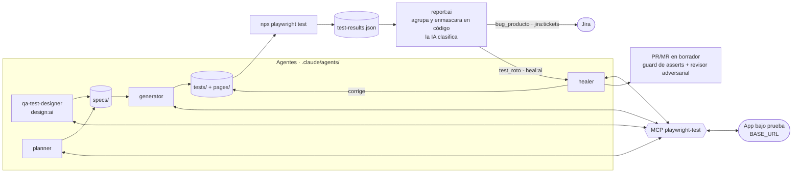

# Plantilla Playwright + IA

Base para empezar la automatización E2E de un proyecto nuevo con Playwright, agentes de Claude Code y un reporte de fallos con IA. No trae tests: solo el framework, el pipeline y las convenciones.

## Primeros pasos

Requisitos: Node 22 o superior y, para los agentes, [Claude Code](https://claude.com/claude-code).

```bash
npm ci
npx playwright install --with-deps
cp .env.example .env        # rellena al menos BASE_URL
npx playwright test         # ejecuta el seed contra BASE_URL
```

Después, para el proyecto concreto:

1. **Seed.** Adapta [`tests/seed.spec.ts`](tests/seed.spec.ts) para que deje la app lista: si hay login, que inicie sesión con credenciales de `.env`. Es lo que usan los agentes para arrancar.
2. **Sesión compartida.** Si casi todos los tests necesitan login, haz un `globalSetup` que guarde el `storageState` en `playwright/.auth/` (ya está en `.gitignore`) y úsalo desde [`fixtures/test.ts`](fixtures/test.ts).
3. **Page objects** en `pages/`, uno por página o componente, y fixtures que los expongan en `fixtures/test.ts`.
4. **Primeros tests** con los agentes: `playwright-test-planner` explora la app y escribe el plan en `specs/`, `playwright-test-generator` lo convierte en tests.
5. **CI.** Define la variable `BASE_URL` y los secretos que vayas a usar (ver [CI](#ci)). Pon la clave del proyecto en [`sonar-project.properties`](sonar-project.properties).

## Estructura

```
.claude/agents/      Agentes: planner, generator, healer, revisor adversarial y diseñador de pruebas
.claude/settings.json  Permisos de los agentes (no leen .env)
.github/             Workflows (tests + reporte IA + healer, guard de asserts, Sonar) y plantilla de PR
.mcp.json            MCP de Playwright (y de SonarQube, opcional) para los agentes
.mcp.figma.json      MCP de Figma para design:ai
docs/diagramas/      Diagramas del circuito y de los controles alrededor de la IA
fixtures/test.ts     test y expect del proyecto: los tests importan de aquí
pages/               Page objects
prompts/             Prompts del reporte IA
scripts/             Reporte IA, triage, healer, guard de asserts, revisor, Jira, dashboard, design:ai
specs/               Planes de prueba, historias (specs/historias/) y diseños
tests/               Specs E2E (seed.spec.ts incluido)
```

## Comandos

| Comando | Qué hace |
|---|---|
| `npm test` | Todos los tests, los tres navegadores |
| `npm run test:chromium` / `test:firefox` / `test:webkit` | Un solo navegador |
| `npm run test:headed` | Con el navegador visible |
| `npm run test:a11y` | Tests etiquetados `@a11y` (con `@axe-core/playwright`) |
| `npm run test:report` | Abre el informe HTML |
| `npm run lint` | `eslint-plugin-playwright` sobre `tests/`, `pages/` y `fixtures/` |
| `npm run test:unit` | Tests unitarios de los scripts |
| `npm run report:ai` | Analiza los fallos de la última ejecución con IA |
| `npm run test:ai` | Tests y reporte IA seguidos |
| `npm run heal:ai` | El healer corrige los `test_roto` y abre una PR/MR en borrador |
| `npm run review:pw` | Revisión adversarial del diff de tests |
| `npm run guard:asserts` | Comprueba que un cambio no relaja aserciones |
| `npm run jira:tickets` | Tickets de Jira para los `bug_producto` (simulado sin credenciales) |
| `npm run design:ai -- HU-XXX` | Diseña las pruebas de una historia de `specs/historias/` a partir de Figma y de la app |
| `npm run dashboard` | Dashboard local con los resultados y el análisis de la IA |

## Cómo encaja todo



### Reporte IA (`report:ai`)

El código agrupa los fallos por causa, marca los flaky y enmascara datos sensibles ([`scripts/triage.mjs`](scripts/triage.mjs)). La IA solo clasifica cada grupo como `test_roto`, `bug_producto` o `entorno`, y con eso redacta el resumen, las correcciones y los tickets. Una ejecución en verde no llama a la IA. Salida en `playwright-report/ai-*`.

Proveedor, por orden: `AI_API_KEY` + `AI_BASE_URL` + `AI_MODEL` (cualquier API compatible con OpenAI), `GEMINI_API_KEY`, o en local sin clave el CLI de Claude con tu suscripción.

### Healer (`heal:ai`)

Solo actúa sobre los `test_roto`. Crea una rama `heal/*`, lanza el agente healer, rechaza cambios fuera de `tests/`, `pages/` y `fixtures/`, pasa el guard de asserts y el revisor adversarial, y abre una PR en borrador (GitHub, con `gh`) o una MR en borrador (GitLab, con `GITLAB_TOKEN`). Si algo no cuadra, la etiqueta `needs-human`. Nunca se fusiona sola.

## CI

Los workflows de [`.github/workflows/`](.github/workflows/) son de GitHub Actions. En un repositorio de GitLab hay que portarlos a `.gitlab-ci.yml`; los scripts no dependen de la plataforma.

| Workflow | Qué hace | Necesita |
|---|---|---|
| `playwright.yml` | Tests en los tres navegadores, lint, reporte IA, tickets de Jira, dashboard y, a mano (`heal: true`), el healer | Variable `BASE_URL`. Secretos `GEMINI_API_KEY` u `OPENROUTER_API_KEY` (+ variable `AI_MODEL`), `JIRA_*` (opcional), `CLAUDE_CODE_OAUTH_TOKEN` (healer) |
| `guard.yml` | Bloquea las PR `heal/*` que relajan una aserción, salvo la etiqueta `asserts-aprobados` | — |
| `sonar.yml` | Análisis de SonarQube con la cobertura de los tests unitarios | Secreto `SONAR_TOKEN` |

## Qué datos salen y hacia dónde

Antes de usarlo con datos de un cliente, revisa esto con quien tenga que aprobarlo:

- **Proveedor de IA.** `report:ai` envía, por cada grupo de fallos, el error y la instantánea de la página en el fallo, recortados y enmascarados (emails, tokens, cookies, contraseñas, query strings, valores de formularios). Las capas gratuitas y las suscripciones personales no dan las mismas garantías de retención que un contrato de empresa.
- **Agentes (healer, revisor, design:ai).** Leen código del repositorio y páginas de la app **sin enmascarar**. No pueden leer `.env` con sus herramientas ([`.claude/settings.json`](.claude/settings.json)) y [`scripts/agent.mjs`](scripts/agent.mjs) les quita del entorno los tokens conocidos, pero el healer puede ejecutar tests. No guardes secretos fuera de `.env`.
- **Jira y artefactos de CI.** Las trazas y los vídeos no pasan por el enmascarado: revisa qué datos de prueba se usan.

Los diagramas de [`docs/diagramas/`](docs/diagramas/) (ábrelos en el navegador) explican el circuito para negocio y los controles alrededor de la IA. Sus fuentes son los `.json`; se regeneran con el skill [archify](https://github.com/tt-a1i/archify):

```bash
node ~/.claude/skills/archify/bin/archify.mjs deliver workflow docs/diagramas/qa-ia-negocio.workflow.json docs/diagramas/qa-ia-negocio.html --quality showcase
```
