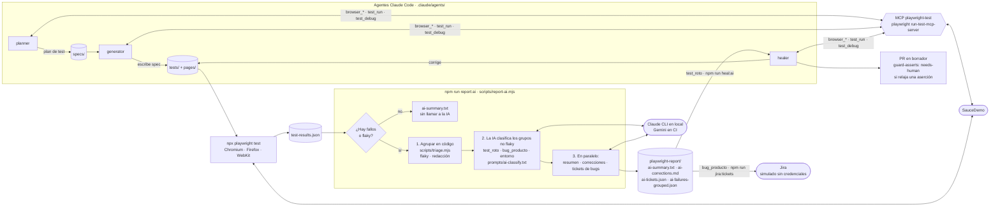
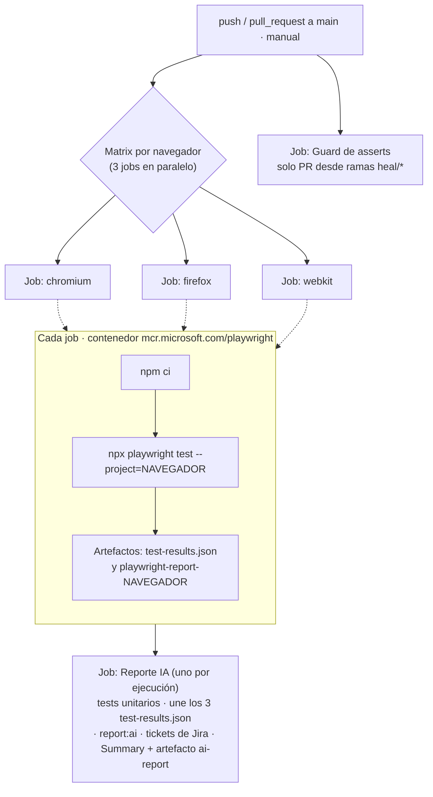

# Playwright E2E · SauceDemo con reporte IA de fallos

Proyecto de automatización de pruebas end-to-end sobre [SauceDemo](https://www.saucedemo.com) utilizando [Playwright](https://playwright.dev/) con TypeScript y el patrón **Page Object Model (POM)**.

## Índice

- [¿Qué demuestra esta demo?](#qué-demuestra-esta-demo)
- [Cómo encaja todo](#cómo-encaja-todo)
- [Learning Lab](#learning-lab)
- [Usuarios de SauceDemo](#usuarios-de-saucedemo)
- [Estructura del proyecto](#estructura-del-proyecto)
- [Requisitos previos](#requisitos-previos)
- [Instalación](#instalación)
  - [Claude Code CLI (opcional, solo para `report:ai` en local)](#claude-code-cli-opcional-solo-para-reportai-en-local)
- [Ejecución de los tests](#ejecución-de-los-tests)
- [Docker](#docker)
  - [¿Cuándo usar Docker?](#cuándo-usar-docker)
  - [Ejecutar los tests en Docker (local)](#ejecutar-los-tests-en-docker-local)
  - [Docker en CI (GitHub Actions)](#docker-en-ci-github-actions)
  - [Flujo del pipeline](#flujo-del-pipeline)
- [Reporte IA (`report:ai`)](#reporte-ia-reportai)
  - [Proveedor de IA](#proveedor-de-ia)
  - [Ficheros generados](#ficheros-generados)
  - [Acierto de la IA](#acierto-de-la-ia)
  - [Ejemplo de salida](#ejemplo-de-salida)
  - [Uso en local](#uso-en-local)
  - [Uso en CI (GitHub Actions)](#uso-en-ci-github-actions)
- [Cerrar el circuito (fase 4)](#cerrar-el-circuito-fase-4)
  - [Healer automático (`npm run heal:ai`)](#healer-automático-npm-run-healai)
  - [Check de asserts (`guard-asserts.mjs`)](#check-de-asserts-guard-assertsmjs)
  - [Revisión adversarial (`npm run review:pw`)](#revisión-adversarial-npm-run-reviewpw)
  - [Lint de Playwright (`npm run lint`)](#lint-de-playwright-npm-run-lint)
  - [Tickets de Jira (`npm run jira:tickets`)](#tickets-de-jira-npm-run-jiratickets)
- [Qué datos salen y hacia dónde](#qué-datos-salen-y-hacia-dónde)
- [Dashboard QA Intelligence](#dashboard-qa-intelligence)
  - [Qué lee y qué enseña](#qué-lee-y-qué-enseña)
  - [No mezclar ejecuciones](#no-mezclar-ejecuciones)
  - [Historial](#historial)
  - [Qué llama a modelos y qué no](#qué-llama-a-modelos-y-qué-no)
  - [Privacidad](#privacidad)
  - [En CI](#en-ci)
  - [Caché de clasificaciones: descartada por ahora](#caché-de-clasificaciones-descartada-por-ahora)
- [Modo headless](#modo-headless)
- [Configuración (`playwright.config.ts`)](#configuración-playwrightconfigts)
- [Decisiones de diseño](#decisiones-de-diseño)
  - [Page Object Model](#page-object-model)
  - [Selectores `data-test`](#selectores-data-test)
  - [`baseURL` en config](#baseurl-en-config)
- [Tecnologías](#tecnologías)

---

## ¿Qué demuestra esta demo?

Suite E2E lista para producción que enseña, sobre una web real, cómo damos valor en QA automation:

- **Page Object Model** — 6 páginas encapsuladas, tests legibles y mantenibles.
- **Cobertura multi-navegador** — 80 tests por navegador (240 en total) en Chromium, Firefox y WebKit.
- **Fallos intencionados** — tests que fallan aposta para demostrar el diagnóstico, no esconderlo.
- **Reporte IA automático** — cada fallo analizado y explicado por IA en el pipeline CI/CD.
- **Circuito cerrado** — los tests rotos acaban en una PR del healer y los bugs de producto en un ticket de Jira. Si una PR automática relaja un test, GitHub bloquea el merge hasta que una persona lo apruebe.

---

## Cómo encaja todo

Los agentes de [`.claude/agents/`](.claude/agents/) crean y reparan los tests. Usan el navegador y el runner a través del servidor MCP de Playwright definido en [`.mcp.json`](.mcp.json). Después, `report:ai` lee los resultados de la ejecución y la IA explica los fallos.



**Versión para negocio.** El mismo circuito sin detalle técnico está en [`docs/diagramas/qa-ia-negocio.html`](docs/diagramas/qa-ia-negocio.html): descárgalo y ábrelo en el navegador, porque GitHub no renderiza HTML. Su fuente es [`qa-ia-negocio.workflow.json`](docs/diagramas/qa-ia-negocio.workflow.json). Si cambia el flujo, edita el JSON y regenera el HTML desde la raíz del repositorio con el skill [archify](https://github.com/tt-a1i/archify). No viene con el repositorio: necesitas tenerlo instalado como skill de Claude Code en `~/.claude/skills/archify`.

```bash
node ~/.claude/skills/archify/bin/archify.mjs deliver workflow docs/diagramas/qa-ia-negocio.workflow.json docs/diagramas/qa-ia-negocio.html --quality showcase
```

---

## Learning Lab

Este repositorio es además el laboratorio de **QA Automation & AI Engineering Learning Lab**, un programa de formación que usa el propio proyecto como material: cada concepto se enseña sobre un fichero y una línea reales, y los defectos deliberados de la suite son los ejercicios de diagnóstico.

El material formativo vive íntegramente en [`learning/`](learning/) y **no modifica el código de automatización**: `tests/`, `pages/`, `scripts/`, `prompts/`, `specs/` y la configuración raíz permanecen intactos.

→ **[learning/README.md](learning/README.md)**

---

## Usuarios de SauceDemo

Los tests usan estos usuarios de prueba, todos con contraseña `secret_sauce`:

| Usuario | Comportamiento | Test |
|---|---|---|
| `standard_user` | Login correcto, flujo normal | mayoría de specs |
| `locked_out_user` | Login bloqueado, muestra error | `login.spec.ts` |
| `problem_user` | Login OK, bugs de UI en catálogo/carrito | `problem-user-cart.spec.ts` |
| `performance_glitch_user` | Login OK, latencia alta | `performance-glitch-user-cart.spec.ts` |

> Credenciales oficiales en la página de login de [SauceDemo](https://www.saucedemo.com); tabla aquí como referencia rápida usada por esta suite.

---

## Estructura del proyecto

```
playwright-demo-ia-mcp/
├── pages/
│   ├── login.page.ts               # POM: página de login
│   ├── inventory.page.ts           # POM: catálogo de productos
│   ├── product-detail.page.ts      # POM: detalle de producto
│   ├── cart.page.ts                # POM: carrito de compras
│   ├── checkout.page.ts            # POM: proceso de checkout
│   └── menu.page.ts                # POM: menú lateral
├── fixtures/
│   └── scenarios.ts                # Escenarios de fallo de la demo (DEMO_SCENARIO)
├── tests/                          # 15 ficheros, 80 tests (incluye seed.spec.ts, arranque de los agentes)
├── specs/                          # Planes de test y documentación QA
├── prompts/                        # Prompts usados por el reporte IA
├── scripts/
│   ├── report-ai.mjs               # Script de análisis IA de resultados
│   ├── triage.mjs                  # Agrupación, flaky y redacción, sin IA
│   ├── triage.test.mjs             # Tests de triage.mjs (npm run test:unit)
│   ├── merge-results.mjs           # Une los resultados de los 3 navegadores en CI
│   ├── merge-results.test.mjs      # Tests de merge-results.mjs (npm run test:unit)
│   ├── dashboard.mjs               # Dashboard QA Intelligence: lee los artefactos, sin IA
│   ├── dashboard-view.mjs          # Métricas y filtros del dashboard (también van dentro de la página)
│   ├── dashboard.html              # Plantilla de la página del dashboard
│   ├── dashboard.test.mjs          # Tests del dashboard (npm run test:unit)
│   ├── heal-ai.mjs                 # Healer automático sobre los test_roto y PR en borrador
│   ├── jira-tickets.mjs            # Tickets de Jira de los bug_producto (simulado sin credenciales)
│   ├── guard-asserts.mjs           # Check que marca needs-human si un cambio relaja las pruebas
│   ├── review-pw.mjs               # Revisión adversarial de un diff de tests (agente revisor)
│   ├── agent.mjs                   # Lanza un agente de .claude/agents/ con claude -p
│   ├── guard-asserts.test.mjs      # Tests del check (npm run test:unit)
│   ├── circuit.test.mjs            # Tests de heal-ai.mjs y jira-tickets.mjs (npm run test:unit)
│   └── ruta-qa-check.mjs           # Comprobación de entorno de la Ruta QA
├── learning/                       # Material del Learning Lab
├── docs-site/                      # Portal Docsify (GitHub Pages)
├── docs/diagramas/                 # Diagrama del circuito para negocio (HTML + fuente archify)
├── .claude/agents/                 # Agentes Playwright: planner, generator, healer y revisor adversarial
├── eslint.config.mjs               # Lint de Playwright (eslint-plugin-playwright)
├── .mcp.json                       # Servidor MCP de Playwright (playwright run-test-mcp-server)
├── .github/workflows/
│   ├── playwright.yml              # Pipeline CI/CD de tests (GitHub Actions)
│   └── docs.yml                    # Publicación del portal en GitHub Pages
├── CLAUDE.md                       # Reglas para Claude Code: revisar la documentación en cambios de arquitectura
├── playwright.config.ts
├── package.json
└── tsconfig.json
```

---

## Requisitos previos

- [Node.js](https://nodejs.org/) v20 o superior (npm se instala con Node)
- [Claude Code CLI](https://claude.ai/code) — opcional, solo para `report:ai` en local (ver [Instalación](#instalación))

> **¿Varias versiones de Node?** Usa [nvm](https://github.com/nvm-sh/nvm) para instalar y cambiar entre versiones sin conflictos:
>
> ```bash
> nvm install 20   # instala Node.js 20 (incluye npm)
> nvm use 20       # activa esa versión en la sesión actual
> ```
>
> En Windows usa [nvm-windows](https://github.com/coreybutler/nvm-windows) (misma sintaxis).

---

## Instalación

```bash
npm install
npx playwright install    # Chromium, Firefox y WebKit
```

### Claude Code CLI (opcional, solo para `report:ai` en local)

```bash
npm install -g @anthropic-ai/claude-code
```

Ejecuta `claude` una vez para autenticarte y sigue el login. En CI el AI report se genera con Gemini, así que el CLI no hace falta allí.

---

## Ejecución de los tests

```bash
# Modo headless (por defecto) — los 3 navegadores
npm test
npm run test:all        # alias explícito de lo anterior

# Un solo navegador
npm run test:chromium
npm run test:firefox
npm run test:webkit

# Modo headed (navegador visible)
npm run test:headed

# Demo: separar suite verde de fallos intencionados
npm run test:demo:green   # solo tests que pasan (excluye @demo-fail)
npm run test:demo:fail    # solo los fallos intencionados (@demo-fail)

# Demo: escenarios de fallo realistas (excluyen @demo-fail)
npm run test:scenario:cascade   # cambio del frontend: unos 70 tests caen por una sola causa
npm run test:scenario:bug       # bug de producto: el badge del carrito cuenta uno de más
npm run test:scenario:flaky     # fallan en el primer intento y pasan al reintentar
npm run test:scenario:env       # entorno caído: el servidor rechaza las conexiones

# Ver el informe HTML tras la ejecución
npm run test:report

# Comprobar el entorno antes de la Ruta QA del Learning Lab
npm run ruta-qa:check
```

Los tests se ejecutan en **Chromium, Firefox y WebKit** (definidos como `projects` en `playwright.config.ts`).

Los fallos intencionados llevan el tag `@demo-fail`. `test:demo:green` demuestra la suite en verde; `test:demo:fail` aísla los fallos que alimentan el AI report.

Los escenarios `test:scenario:*` simulan fallos de los que se ven en un proyecto real, sin tocar los tests: el fixture [`fixtures/scenarios.ts`](fixtures/scenarios.ts) lee `DEMO_SCENARIO` y modifica la página antes de cada test. Sin la variable, la suite se comporta igual.

---

## Docker

El proyecto puede ejecutar los tests dentro del contenedor oficial de Playwright. La imagen trae Node, los tres navegadores y todas las dependencias del sistema preinstaladas, garantizando un **entorno idéntico** en local y en CI.

> El tag de la imagen (`v1.58.2-jammy`) debe coincidir con la versión de `@playwright/test` del `package-lock.json`. Si actualizas Playwright, actualiza también el tag en el workflow y en los comandos.

### ¿Cuándo usar Docker?

- **CI/CD:** entorno reproducible sin instalar navegadores en cada run.
- **Consistencia entre equipos:** mismo navegador, misma versión, mismo SO. Elimina el "en mi máquina funciona".
- **Reproducir el CI en local** antes de subir cambios.

Para el desarrollo diario iterando tests, ejecuta `npm test` directamente: Docker añade una capa más lenta sin beneficio en ese caso.

### Ejecutar los tests en Docker (local)

Replica exactamente el entorno del CI. Requiere **Docker Desktop** en ejecución y ejecutarse desde la raíz del proyecto.

```powershell
# PowerShell (recomendado en Windows)
docker run --rm -v "${PWD}:/work" -w /work mcr.microsoft.com/playwright:v1.58.2-jammy bash -c "npm ci && npx playwright test"
```

```bash
# Git Bash (desactiva la conversión de rutas de MSYS)
MSYS_NO_PATHCONV=1 docker run --rm -v "/$(pwd):/work" -w //work mcr.microsoft.com/playwright:v1.58.2-jammy bash -c "npm ci && npx playwright test"
```

El volumen montado (`-v`) persiste el `playwright-report/` generado en tu disco. Para verlo tras el run necesitas Playwright instalado en local:

```bash
npm ci
npm run test:report
```

### Docker en CI (GitHub Actions)

El workflow [`.github/workflows/playwright.yml`](.github/workflows/playwright.yml) ejecuta el job dentro de la imagen mediante `container:`. No necesita pasos de `setup-node` ni `playwright install`: la imagen ya lo trae todo.

Se dispara con `push` o `pull_request` a `main`, o manualmente. En `push` y `pull_request` ejecuta la suite verde (excluye `@demo-fail`). En el lanzamiento manual se elige la suite con el input `suite`: `green` (por defecto), `fail` o `all`.

```bash
# Lanzar el workflow manualmente (requiere gh CLI)
gh workflow run "Playwright Tests"                 # suite verde
gh workflow run "Playwright Tests" -f suite=fail   # solo fallos intencionados

# Seguir el último run en vivo
gh run watch
```

### Flujo del pipeline



> Los tres navegadores van en paralelo y el reporte IA se genera **una sola vez** con los resultados de los tres ([`scripts/merge-results.mjs`](scripts/merge-results.mjs)): como mucho 4 llamadas a la IA por ejecución, y un fallo que se repite en los tres navegadores sale como un único grupo. En push y PR, si lo único que hay son tests flaky, no se llama a la IA. Para ver el **AI report** analizar fallos reales, lanza el workflow a mano con `suite=fail` o `suite=all`.

---

## Reporte IA (`report:ai`)

El script `report:ai` analiza los resultados de la última ejecución y genera cuatro ficheros de salida en `playwright-report/`.

Lo que se puede decidir con reglas lo hace el código, en [`scripts/triage.mjs`](scripts/triage.mjs):
- **Agrupa** los fallos por causa: patrón del fallo más el elemento implicado. No usa la primera línea del error, porque los mensajes personalizados de los `expect` la cambian en cada test.
- **Marca como flaky** los tests que fallaron y pasaron al reintentar.
- **Enmascara datos sensibles** antes de enviar nada a la IA: emails, tokens, cookies, query strings, valores escritos en formularios y rutas con nombre de usuario.

La IA solo **clasifica** los grupos que no son flaky, como `test_roto`, `bug_producto` o `entorno`, con confianza, evidencia y acción recomendada. Para decidir, compara lo que espera el test con la instantánea de la página en el momento del fallo (`error-context.md`). Con esa clasificación redacta el resumen y las correcciones, y abre tickets solo para los `bug_producto`.

### Proveedor de IA

El script elige el proveedor según el entorno:

- **En local:** el CLI de Claude (`claude`) con tu suscripción. No requiere API key.
- **En CI:** si existe la variable `GEMINI_API_KEY`, usa **Google Gemini** (`gemini-flash-latest`, free tier). Así el pipeline no consume crédito de pago.

La presencia de `GEMINI_API_KEY` es lo que decide el proveedor (ver `runClaude` en [`scripts/report-ai.mjs`](scripts/report-ai.mjs)).

El flujo completo del script está en el diagrama de [Cómo encaja todo](#cómo-encaja-todo).

### Ficheros generados

| Fichero | Descripción |
|---------|-------------|
| `playwright-report/ai-summary.txt` | Resumen ejecutivo: totales, estado global y conclusión |
| `playwright-report/ai-corrections.md` | Posibles causas y correcciones para cada fallo |
| `playwright-report/ai-tickets.json` | Tickets en formato Jira (JSON importable), solo para los `bug_producto` |
| `playwright-report/ai-failures-grouped.json` | Grupos de fallos con su clasificación: tipo, confianza, evidencia y acción |

### Acierto de la IA

`npm run eval:ai` ejecuta cada escenario de fallo en chromium, lanza `report:ai` y compara el tipo que asigna la IA a cada grupo con la respuesta esperada de [`specs/ai-golden.json`](specs/ai-golden.json). El resultado queda en `playwright-report/ai-eval.md` y, con los mismos datos, en `ai-eval.json` (lo lee el [dashboard](#dashboard-qa-intelligence)). Solo hace la llamada de clasificación (una por escenario), no el resumen ni las correcciones. En CI se lanza a mano con `suite=eval` (usa Gemini) y la cifra sale en el resumen de la ejecución. Si la IA no responde, por ejemplo por cuota agotada, esos grupos salen como no evaluados y no cuentan en la cifra.

> La capa gratuita de Gemini permite 20 peticiones al día y 5 por minuto. Una evaluación gasta 4, y una ejecución de CI con fallos, otras 4 como mucho (el reporte es uno para los tres navegadores). Una CI en verde no gasta ninguna, aunque haya algún test flaky.

Última medición (Claude Haiku 5.5, en local, 21 de octubre de 2026): **11 de 11 grupos bien clasificados, que cubren 185 de 185 tests fallados**.

| Escenario | Esperado | Grupos | Acierto | Tiempo del reporte |
|---|---|---|---|---|
| `demo-fail` | test_roto | 7 | 7/7 | 57 s |
| `cascade` | test_roto | 1 | 1/1 | 23 s |
| `bug` | bug_producto | 2 | 2/2 | 34 s |
| `env` | entorno | 1 | 1/1 | 21 s |
| `flaky` | flaky (lo decide el código) | 1 | 1/1 | 19 s |

> Son 5 escenarios controlados y una sola ejecución: demuestra que la clasificación funciona, no que acierte siempre en un proyecto real. Para medirlo en un proyecto real, añade sus fallos conocidos a `specs/ai-golden.json`.

### Ejemplo de salida

> Salida real de `npm run test:scenario:bug -- --project=chromium` seguido de `npm run report:ai`. El escenario hace que el badge del carrito cuente un producto de más.

`ai-summary.txt`:

```
RESUMEN DE EJECUCIÓN – PLAYWRIGHT E2E 🎭
Fecha: 21 de octubre de 2026, a las 13:55

RESULTADO GLOBAL
Total de pruebas ejecutadas: 70
✅ Pruebas correctas:           35
❌ Pruebas fallidas:            35
⏭️ Pruebas omitidas:            0
⚠️ Pruebas inestables (flaky):  0

ATENCIÓN REQUERIDA
El contador del carrito muestra un producto de más en 34 pruebas (fallo de la aplicación). Al añadir un solo artículo, el número del carrito marca 2 mientras el texto del propio carrito indica 1.
El contador del carrito cuenta 4 productos cuando la lista muestra 3, en la prueba con el usuario problem_user (fallo de la aplicación).

CONCLUSIÓN
Los 35 fallos son defectos reales de la aplicación en el contador del carrito, no errores de las pruebas. Es un riesgo para producción, porque un cliente vería cifras incorrectas en su carrito, así que hay un bloqueo que conviene resolver antes de publicar. El resto de las pruebas, 35 en total, sí han pasado correctamente.

ACCIONES RECOMENDADAS
1. Abrir una incidencia de fallo de la aplicación sobre el contador del carrito, usando el caso de las 34 pruebas como referencia.
2. Incluir en esa incidencia el caso del usuario problem_user, que muestra 4 cuando la lista tiene 3 productos.
3. No modificar las pruebas: fallan porque la aplicación se comporta mal, no porque estén mal escritas.
4. Repetir la ejecución tras la corrección y no publicar hasta que las pruebas del contador del carrito pasen.
```

Fragmento de `ai-corrections.md`:

```markdown
### G001 – bug_producto – Error: El badge del carrito debería mostrar 1 tras añadir la Sauce Labs Bolt T-S…

🔍 **Diagnóstico:** El badge muestra "2" con un solo producto añadido, y el botón del carrito dice "Cart, 1 items". La página contradice su propio estado. La instantánea solo muestra la Sauce Labs Bolt T-Shirt en el inventario, y el test espera 1 (confianza: alta).

🔧 **Pasos para corregir:**
1. Abrir bug a producto: el badge del carrito muestra 2 con un solo producto añadido y no coincide con el texto accesible "Cart, 1 items".
2. Adjuntar el error de `expect(locator).toHaveText(expected)` (Expected: "1", Received: "2") y la instantánea del fallo.
3. No modificar los tests: dejarlos fallando como evidencia del bug.
```

### Uso en local

```bash
# Requiere haber ejecutado los tests antes (ver "Ejecución de los tests")
npm run report:ai

# Alternativa: tests + reporte en un único comando
npm run test:ai

# Medir el acierto de la IA con los escenarios de fallo
npm run eval:ai
```

### Uso en CI (GitHub Actions)

El reporte se ejecuta automáticamente en el job **Reporte IA**, una vez por ejecución y con los resultados de los tres navegadores juntos. El resumen aparece en la pestaña **Summary** del workflow sin necesidad de descargar ningún artefacto, y los ficheros completos están en el artefacto `ai-report`.

Requiere el secret `GEMINI_API_KEY` configurado en el repositorio:
**Settings > Secrets and variables > Actions > New repository secret**

Crea una key gratuita (sin tarjeta) en [aistudio.google.com/apikey](https://aistudio.google.com/apikey).

---

## Cerrar el circuito (fase 4)

Después de `report:ai`, cada tipo de fallo tiene su salida:

| Tipo | Qué pasa | Cómo |
|---|---|---|
| `test_roto` | El healer corrige el test y abre una PR en borrador. Nunca se fusiona sola | `npm run heal:ai`, en local |
| `bug_producto` | Ticket de Jira con la traza y el vídeo de los tests afectados. El healer no toca estos tests | `npm run jira:tickets`, en local y en CI |
| `flaky` / `entorno` | Solo el aviso del resumen, sin acción automática | — |

### Healer automático (`npm run heal:ai`)

```bash
npm run heal:ai                          # todos los test_roto del último report:ai
npm run heal:ai -- --group G001          # solo ese grupo (se puede repetir)
npm run heal:ai -- --dry-run             # enseña lo que recibiría el healer; no toca git, GitHub ni la IA
DEMO_SCENARIO=cascade npm run heal:ai    # con un escenario: la misma variable que al lanzar los tests
```

1. Lee `playwright-report/ai-failures-grouped.json` y se queda solo con los grupos `test_roto`. Aunque se pida a mano un `bug_producto`, no lo cura.
2. Exige un árbol de trabajo limpio y crea una rama `heal/<grupos>-<fecha>`.
3. Lanza `claude -p` con el agente `playwright-test-healer` y el servidor MCP de [`.mcp.json`](.mcp.json). Le pasa el diagnóstico de cada grupo y unas reglas: cambiar lo mínimo, no relajar asserts y no tocar nada fuera de `tests/`, `pages/` y `fixtures/`.
4. Si toca otros ficheros, para y no abre PR. Si no cambia nada, borra la rama.
5. Pasa el check de asserts y la [revisión adversarial](#revisión-adversarial-npm-run-reviewpw). Después confirma, hace push y abre una **PR en borrador** con `gh`, con el diagnóstico, el veredicto del revisor y el resumen del healer. Si el check encuentra algo o el revisor no aprueba el cambio, la PR lleva la etiqueta `needs-human`.
6. Deja el resultado en `playwright-report/ai-heal.json` y vuelve a tu rama.

Usa tu suscripción de Claude (el agente va con Sonnet) y necesita `gh` autenticado. Tarda varios minutos, porque el healer ejecuta y depura los tests. En CI todavía no se lanza: haría falta un token de Claude en los secretos del repositorio.

> Con los `@demo-fail`, la corrección correcta es cambiar el valor esperado (`'3'` por `'4'`): la PR sale con `needs-human`, que es lo que debe pasar. **No la fusiones**: esos tests fallan aposta para la demo.

### Check de asserts (`guard-asserts.mjs`)

Es la protección que no depende de la IA. Si la clasificación se equivocara y el healer "arreglara" un bug real bajando la expectativa, el check lo marca. Compara cada aserción por su matcher y sus argumentos, sin el sujeto, porque cambiar un selector es justo lo que debe poder hacer el healer. Pide revisión humana si:

- desaparece una aserción o cambia su valor esperado, o se le añade `.not`;
- se añade `test.skip`, `test.fixme` o `test.fail`;
- aparece un timeout nuevo o `test.slow()`;
- se borra un fichero de `tests/`, `pages/` o `fixtures/`, o cambia `playwright.config.ts`.

```bash
npm run guard:asserts -- main     # compara main con tu árbol de trabajo
```

En CI corre en su propio workflow ([`guard.yml`](.github/workflows/guard.yml)), solo en las PR que salen de ramas `heal/*`. Falla si encuentra algo. Es un **check obligatorio de `main`**: mientras está en rojo, GitHub no deja fusionar la PR, tampoco a los administradores. En las demás PR sale como omitido, que cuenta como superado.

Cuando el cambio es legítimo (el valor antiguo estaba mal), una persona lo aprueba poniendo la etiqueta **`asserts-aprobados`** en la PR. El check se vuelve a ejecutar y pasa. La aprobación vale solo para los commits revisados: si llega otro, el workflow retira la etiqueta y el check vuelve a mirar el cambio.

### Revisión adversarial (`npm run review:pw`)

El agente [`playwright-adversarial-reviewer`](.claude/agents/playwright-adversarial-reviewer.md) solo lee: intenta demostrar que el cambio está mal. Busca, de más a menos grave:

- **Ocultar un bug:** un locator que apunta a otro elemento (más amplio, con `.first()` o con un `filter` que no casa con nada), una comprobación más laxa o un paso que desaparece.
- **Locators ambiguos o frágiles.**
- **Riesgos de flaky.**
- **Convenciones del repositorio:** page objects, imports de `fixtures/scenarios`, tests `@demo-fail` y líneas citadas en `learning/`.
- **Alcance:** apariciones del mismo patrón que se han quedado sin corregir.

Para cada hallazgo intenta construir el caso concreto en el que el test nuevo pasaría con la aplicación rota. Recibe el diff, el resultado del check de asserts y el lint de los ficheros cambiados. Responde con `VEREDICTO: APROBADO`, `DUDAS` o `RECHAZADO` y una lista de hallazgos.

```bash
npm run review:pw -- main      # cualquier cambio en tests/, pages/, fixtures/ o la configuración frente a main
```

`heal:ai` lo lanza solo antes de abrir cada PR. Para las PR de personas se lanza a mano. Usa Claude CLI con tu suscripción (Sonnet).

Cubre lo que el check de asserts no mira, que es el sujeto de cada `expect`. Probado con una trampa: cambiar `inventoryPage.cartBadge` por `inventoryPage.cartBadge.filter({ hasText: 'vacío' })` en un `not.toBeVisible()`. El check no ve nada, y el revisor lo rechaza: el locator no casa con ningún elemento, así que el test pasaría aunque el badge apareciera con el carrito vacío.

### Lint de Playwright (`npm run lint`)

[`eslint-plugin-playwright`](https://github.com/playwright-community/eslint-plugin-playwright) con su configuración recomendada, sin IA, sobre `tests/`, `pages/` y `fixtures/`. Detecta `await` que faltan, `waitForTimeout`, `force: true`, `test.only` y `skip`, y aserciones que no esperan al elemento. En CI es el job **Lint de Playwright**, en cada push y PR. Falla con cualquier error o si aparece un aviso más de los 17 que hay hoy (13 `no-useless-not` y 4 condicionales en `problem-user-cart.spec.ts`): esa deuda queda a la vista y no puede crecer. Si se corrige alguno, baja `--max-warnings` en `package.json`.

### Tickets de Jira (`npm run jira:tickets`)

Convierte `ai-tickets.json` en peticiones a la API REST v3 de Jira: título, descripción, tests afectados, solución sugerida, etiquetas (severidad, componente y ejecución) y **prioridad**. La prioridad sale de la severidad, por posición entre las que admite el proyecto (`bloqueante` toma la más urgente), o por nombre con `JIRA_PRIORITY_MAP="bloqueante=Highest,alta=High,media=Medium,baja=Low"`. Así el icono de color de la prioridad sale en la tarjeta. Para colorear la tarjeta entera, en un tablero de Jira Software está en *Configuración del tablero > Colores de las tarjetas > Prioridad*. Adjunta la traza y el vídeo de hasta 3 tests del grupo, solo si son de la misma ejecución que el análisis.

- **Modo simulado** (por defecto): sin credenciales no envía nada. Deja las peticiones completas y la lista de adjuntos en `playwright-report/ai-jira.json`. En CI va dentro del artefacto `ai-report`.
- **Modo real**: con `JIRA_BASE_URL`, `JIRA_EMAIL`, `JIRA_API_TOKEN` y `JIRA_PROJECT_KEY` crea los tickets y sube los adjuntos. En local se leen solos de `.env` (que no está en git); en CI, de los secretos del repositorio. `JIRA_ISSUE_TYPE` es opcional (por defecto, `Bug`; tiene que existir en el proyecto). Si el proyecto exige informador al crear por API, se pone la cuenta del token. Volver a lanzarlo crea tickets duplicados.
- En CI los tickets salen sin adjuntos: la traza y el vídeo se quedan en los jobs de cada navegador.

Los textos pasan por el mismo redactor que el triage. Las trazas y los vídeos no: en un proyecto real, revisa qué contienen antes de activarlo.

---

## Qué datos salen y hacia dónde

Resumen para quien tenga que aprobar el uso en un cliente: qué sale de la máquina o del pipeline, hacia dónde, y qué controles hay. El dashboard no aparece porque no envía nada.

| Destino | Quién lo envía | Qué sale | Qué no sale |
|---|---|---|---|
| **Anthropic** (Claude CLI, con tu suscripción, en local) | `report:ai`, `eval:ai` | Por cada grupo de fallos: patrón y huella, número de tests y navegadores, hasta 10 tests (título, fichero, línea y navegador), el error recortado a 1500 caracteres y la instantánea de la página en el fallo (`error-context.md`) recortada a 3000. Todo pasa antes por el redactor. Para el resumen, las correcciones y los tickets solo va un extracto del error de 600 caracteres, sin la instantánea | `test-results.json` completo, el código de los tests, trazas, vídeos, capturas y variables de entorno |
| **Google** (Gemini API, capa gratuita, en CI) | `report:ai`, `eval:ai` en el pipeline | Lo mismo que la fila anterior | Lo mismo que la fila anterior |
| **Anthropic** (Claude CLI, en local) | `heal:ai` | El diagnóstico de los grupos `test_roto` (los mismos campos redactados) y, además, **lo que el agente lea o ejecute**: ficheros del repositorio y las instantáneas de la página de los tests que lanza a través del servidor MCP. **Esto no pasa por el redactor** | `.env`: [`.claude/settings.json`](.claude/settings.json) prohíbe leerlo (comprobado con Read y con Grep). Secretos de CI, porque se ejecuta en local. No tiene terminal (`Bash`) |
| **Anthropic** (Claude CLI, en local) | `review:pw` | El diff de `tests/`, `pages/`, `fixtures/` y `playwright.config.ts`, el resultado del check de asserts, el lint y los ficheros que el agente decida leer. Sin redactar | `.env` (misma regla). Nada se ejecuta: el agente solo lee |
| **GitHub** | `heal:ai` | La rama `heal/*` con el cambio y la descripción de la PR: diagnóstico, veredicto del revisor y resumen del healer | — |
| **GitHub Actions** (artefactos) | El pipeline | Informe HTML de Playwright (30 días), trazas y vídeos de los tests fallidos (7 días), `test-results.json` (1 día) y el artefacto `ai-report` con los `ai-*`, el dashboard y `ai-jira.json` (30 días). Los ve quien tenga acceso de lectura al repositorio | — |
| **Tu Jira** (`JIRA_BASE_URL`) | `jira:tickets`, solo con las variables `JIRA_*` | Título, descripción, tests afectados y solución sugerida (redactados), etiquetas, prioridad y, en local, **la traza y el vídeo de hasta 3 tests por ticket, sin redactar**. Una traza lleva el DOM, las peticiones de red y la consola de la sesión | Sin credenciales es modo simulado y no sale nada |
| **CodeRabbit** (app de GitHub del repositorio) | Cada PR | El diff de la PR | — |

**Controles que lo respaldan**

- **Lista de campos permitidos.** Hacia la IA solo salen los campos que construye `groupFailures` en [`scripts/triage.mjs`](scripts/triage.mjs). El informe de Playwright no se envía entero.
- **Redactor** (`redact` en `triage.mjs`, con tests en [`scripts/triage.test.mjs`](scripts/triage.test.mjs)). Enmascara:
  - JWT y cabeceras `Authorization`, `Cookie` y `Set-Cookie`;
  - valores de `password`, `secret`, `token` y `api_key`;
  - emails y query strings de las URLs;
  - lo que se escribe con `fill()` y los valores de los campos de texto de la instantánea;
  - las rutas con nombre de usuario.

  Se redacta antes de recortar, para que un token partido por el corte no se escape.
- **Sin IA cuando no hace falta.** Una ejecución en verde no llama a la IA. En push y PR tampoco se llama si solo hay tests flaky. La agrupación y la detección de flaky se hacen en código.
- **Los agentes no leen `.env`.** [`.claude/settings.json`](.claude/settings.json) prohíbe a Claude Code leer `.env` y `.env.*` en este proyecto, también al healer y al revisor. El resto del repositorio sí lo pueden leer: no guardes secretos en otros ficheros.
- **Jira simulado por defecto.** Sin las variables `JIRA_*` no se envía nada. En CI los tickets saldrían sin adjuntos.
- **El dashboard no se conecta a nada.** Tiene una CSP `default-src 'none'` y vuelve a pasar el redactor por todos los textos.

**Lo que hay que decidir con cada cliente**

- **Proveedor y condiciones.** Las capas gratuitas y las suscripciones personales no ofrecen las mismas garantías de uso y retención de datos que un contrato de empresa. Hay que revisar las condiciones del proveedor que se use (Gemini API, Anthropic, Bedrock o Vertex) antes de enviar datos de un cliente.
- **Healer y revisor.** Leen código del repositorio sin redactar (todo menos `.env`). En un proyecto con secretos o datos reales en otros ficheros, hay que ampliar la lista de `deny` o ejecutarlos con un proveedor aprobado por el cliente.
- **Adjuntos de Jira y artefactos de CI.** Las trazas y los vídeos no pasan por el redactor. Hay que revisar qué datos de prueba se usan y la retención de los artefactos.

---

## Dashboard QA Intelligence

Una página web local que enseña el flujo completo de una ejecución: tests → grupos de fallos → clasificación → evidencia → acción recomendada → acierto de la IA. **No usa IA**: lee los ficheros que ya han generado Playwright, `report:ai` y `eval:ai`, y no vuelve a generar nada.

```bash
npm run dashboard               # lee test-results.json y playwright-report/ → playwright-report/qa-dashboard.html
npm run dashboard -- --save     # además guarda esta ejecución (y la evaluación, si hay) en el historial
npm run dashboard:demo          # datos de ejemplo de learning/ruta-qa/ejemplos → qa-dashboard-demo.html
npm run dashboard -- --dir <carpeta>   # otra carpeta, p. ej. el artefacto ai-report descargado de CI
```

Abre el `.html` generado directamente en el navegador: no necesita servidor, conexión, dependencias nuevas ni claves de IA. Para trabajar en la interfaz sin gastar cuota, usa `dashboard:demo` o cualquier carpeta con artefactos ya generados.

### Qué lee y qué enseña

| Artefacto | Lo genera | En el dashboard | Si falta |
|---|---|---|---|
| `test-results.json` | Playwright (o `merge-results.mjs` en CI) | Total, pasados, fallidos, omitidos, flaky, % de éxito, navegadores, identificador de la ejecución | Las métricas de tests salen como `n/d` y el resto de ficheros no se puede vincular a una ejecución |
| `ai-failures-grouped.json` | `report:ai` | Grupos con categoría, origen, confianza, evidencia, acción, tests, navegadores, error e instantánea; filtros y búsqueda | No hay grupos ni distribución por categoría |
| `ai-summary.txt`, `ai-corrections.md`, `ai-tickets.json` | `report:ai` | Resumen, correcciones sugeridas y tickets propuestos | Se indica que no existen |
| `ai-eval.json` (o `ai-eval.md` antiguo) | `eval:ai` | Acierto por grupos y por tests, tests en grupos correctos e incorrectos, resultado por escenario, proveedor y fecha | Estado vacío que explica cómo generarla |

Un fichero inexistente, vacío, con JSON malformado o con un formato antiguo no rompe la página: la sección **Artefactos leídos** dice qué se ha podido usar y por qué no.

- **Tests y grupos van por separado.** Los tests cuentan una vez por navegador; un grupo es una causa (70 tests de `cascade` son 1 grupo). Nunca se suman.
- **Origen de la clasificación.** `flaky` lo decide el código (*Determinista*); `test_roto`, `bug_producto` y `entorno`, la IA; `sin_clasificar` es que la clasificación falló. Las categorías son las mismas cinco del triage.
- **Pendientes de revisión.** Los artefactos no guardan un estado de revisión. Se marcan los `sin_clasificar` y los de la IA con confianza distinta de `alta`.
- **Recomendado no es ejecutado.** Las acciones, correcciones y tickets se muestran como propuestas. El dashboard es de solo lectura: no lanza el healer, no abre PR y no crea tickets. Las acciones ejecutadas salen como "ninguna registrada", porque el circuito automático (fase 4) aún no existe.
- **Peticiones a la IA y proveedor.** Desde esta versión `report:ai` guarda en `ai-failures-grouped.json` el proveedor y el número de peticiones que hizo (`ai_requests`, reintentos incluidos). En informes anteriores salen como `n/d`. No hay datos de tokens ni de coste, así que no se muestran.
- Cada indicador explica cómo se calcula en el desplegable **Cómo se calcula cada indicador**, al final de la página.

### No mezclar ejecuciones

`report:ai` guarda ahora `run_start_time` (la hora de inicio que pone Playwright en `test-results.json`), y el dashboard solo asocia el análisis a la ejecución si coincide. En informes anteriores compara los contadores de fallos y flaky y la fecha de los ficheros. `ai-summary.txt`, `ai-corrections.md` y `ai-tickets.json` no llevan identificador: solo se muestran si son posteriores a `test-results.json`. Lo que es de otra ejecución no se muestra y aparece un aviso. Esto importa porque `report:ai` no borra los ficheros de la ejecución anterior cuando no tiene nada que analizar.

### Historial

`--save` copia los datos normalizados de la ejecución actual a `qa-history/runs/<hora-de-inicio>.json` y los de la evaluación a `qa-history/evals/<fecha>.json`. La carpeta es local y no está en git. El selector **Ejecución** de la cabecera y la tabla **Historial** permiten ver cada una por separado.

Para añadir una ejecución al historial, encadena los tres pasos y abre la página:

```bash
# bash (Git Bash, terminal de VS Code)
PLAYWRIGHT_HTML_OPEN=never npm test; npm run report:ai; npm run dashboard -- --save; start playwright-report/qa-dashboard.html
```

```powershell
# PowerShell
$env:PLAYWRIGHT_HTML_OPEN = "never"; npm test; npm run report:ai; npm run dashboard -- --save; start playwright-report\qa-dashboard.html
```

- Van con `;` y no con `&&`: si hay tests fallidos, `npm test` termina con error y `&&` cortaría la cadena antes de `report:ai`. Por eso aquí no sirve `npm run test:ai`.
- `PLAYWRIGHT_HTML_OPEN=never` evita que Playwright se quede sirviendo su informe HTML (`Serving HTML report at …`) cuando hay fallos, que bloquea la cadena hasta pulsar Ctrl+C.
- `report:ai` consume cuota de IA y no da una estimación de tiempo: termina con `✅ AI Reporting finalizado correctamente`.

Limitaciones:

- Solo se guarda lo que se guarda a mano: lanza `--save` cuando `report:ai` haya terminado. Si ya existe una copia de esa ejecución, no se sobrescribe; borra el fichero si necesitas rehacerla.
- Una ejecución sin `test-results.json` no tiene identificador y no se puede guardar. Una evaluación que solo tiene `ai-eval.md` tampoco.
- Las evaluaciones tienen su propio historial y no se asocian a una ejecución: `eval:ai` lanza cinco ejecuciones seguidas y deja en disco la última.
- La demo nunca lee ni escribe el historial.

### Qué llama a modelos y qué no

| Componente | ¿Llama a la IA? |
|---|---|
| `npm run report:ai` | Sí: clasificación, resumen, correcciones y tickets (Claude CLI en local, Gemini en CI) |
| `npm run eval:ai` | Sí: una clasificación por escenario. El dashboard nunca lo lanza |
| `npm run heal:ai` | Sí: el agente healer (Claude CLI, en local). El dashboard nunca lo lanza |
| `npm run review:pw` | Sí: el agente revisor (Claude CLI, en local). También lo lanza `heal:ai` |
| `npm run jira:tickets`, `guard:asserts` y `lint` | No |
| `npm run dashboard`, `dashboard:demo` y la página generada | No. Solo leen ficheros, no ejecutan tests y no necesitan claves |

La página lleva una Content-Security-Policy `default-src 'none'`, que bloquea cualquier conexión de red, y los tests unitarios comprueban que ni el script ni la página contienen llamadas de red, procesos ni claves.

### Privacidad

El dashboard no envía nada a ningún sitio. Muestra lo mismo que ya contienen los artefactos, que salen redactados de `triage.mjs`, y además vuelve a pasar el redactor por todos los textos, por si el informe es antiguo. Los datos se escriben dentro de la página como texto, nunca como HTML, así que un mensaje de error no puede inyectar código. No incluye capturas, vídeos ni trazas. Aun así, el `.html` contiene errores e instantáneas de la página: trátalo como el resto del artefacto `ai-report`. **No se publica en GitHub Pages.**

### En CI

Los jobs **Reporte IA** y **Acierto de la IA** generan `qa-dashboard.html` con los ficheros que ya tienen y lo suben dentro de sus artefactos (`ai-report`, `ai-eval`). Es un paso que solo lee ficheros: no gasta cuota de IA, no repite los tests, no pide permisos nuevos y, si fallara, no tumba el job. Para verlo, descarga el artefacto y abre el `.html`.

### Caché de clasificaciones: descartada por ahora

Se valoró guardar las clasificaciones para no volver a pedirlas. No compensa en esta fase: la huella del grupo no basta como clave, porque la evidencia que decide (el error completo y la instantánea de la página) cambia aunque la huella sea la misma. Una caché segura tendría que usar como clave todo lo que se envía a la IA más el prompt, el modelo y la taxonomía, y guardar los contextos redactados. Eso cambia el comportamiento del triage y merece su propia rama. El ahorro que sí hay ya está hecho: un solo reporte por ejecución en CI, nada de IA si solo hay flaky (`AI_SKIP_FLAKY_ONLY`) y una evaluación que solo clasifica.

---

## Modo headless

El modo **headless** ejecuta los tests sin abrir ventana de navegador. Es el modo por defecto y el recomendado para CI/CD.

```bash
# Un fichero específico
npx playwright test tests/login.spec.ts

# Un test por nombre (grep)
npx playwright test --grep "debería redirigir a la página de inventario"

# Con reintentos y tracing
npx playwright test --retries=2 --trace=on
```

---

## Configuración (`playwright.config.ts`)

| Parámetro | Valor |
|-----------|-------|
| `baseURL` | `https://www.saucedemo.com` |
| `testDir` | `./tests` |
| `reporter` | HTML + JSON (local) · GitHub + HTML + JSON (CI) |
| `trace` | `retain-on-failure` |
| `video` | `retain-on-failure` |
| Browsers | Chromium · Firefox · WebKit |
| Reintentos en CI | 2 |
| Workers en CI | 4 |

---

## Decisiones de diseño

### Page Object Model
Cada página tiene su propia clase en `/pages`. Los tests solo orquestan el flujo de negocio; los selectores y acciones quedan encapsulados en los page objects.

```typescript
// pages/login.page.ts
export class LoginPage {
  readonly errorMessage: Locator;

  constructor(private readonly page: Page) {
    this.errorMessage = this.page.locator('[data-test="error"]');
  }

  async navigate(): Promise<void> {
    await this.page.goto('/');
  }

  async login(username: string, password: string): Promise<void> {
    await this.page.locator('[data-test="username"]').fill(username);
    await this.page.locator('[data-test="password"]').fill(password);
    await this.page.locator('[data-test="login-button"]').click();
  }
}
```

```typescript
// tests/login.spec.ts
test('debería mostrar error cuando las credenciales no corresponden a ningún usuario', async () => {
  await loginPage.login('wrong_user', 'wrong_password');

  await expect(loginPage.errorMessage).toBeVisible();
  await expect(loginPage.errorMessage).toContainText(
    'Username and password do not match any user in this service',
  );
});
```

El test no conoce selectores ni pasos de UI, solo llama métodos del page object.

### Selectores `data-test`
Se usan los atributos `data-test` que provee SauceDemo, los más resilientes ante cambios de estilos o estructura HTML. La excepción es el menú lateral ([`pages/menu.page.ts`](pages/menu.page.ts)), que usa selectores por `id` (`#react-burger-menu-btn`, `#logout_sidebar_link`…).

### `baseURL` en config
La URL base se define una sola vez en `playwright.config.ts`. Los page objects usan rutas relativas, lo que simplifica un eventual cambio de entorno.

---

## Tecnologías

- [Playwright](https://playwright.dev/) `1.58`
- TypeScript `^5.0`
- Node.js `^20`
- Claude Code CLI (reporte IA en local)
- Google Gemini `gemini-flash-latest` (reporte IA en CI)
- Playwright MCP + agentes planner / generator / healer
